# Client Websites

Websites I designed and built for clients through my studio. Each is hand-written HTML, CSS and JavaScript, with no templates or site builders.

| Site | Client | What I built |
|---|---|---|
| [`cleopatra/`](cleopatra/) | Actor and voice artist | Portfolio with a video landing page, photo gallery, demo reel, voice demos and a contact form |
| [`other-half/`](other-half/) | Film production company | One-page site with trailers, film stills and an inquiry form |
| [`meta-angel/`](meta-angel/) | META ANGEL live event | Event landing page with animated visuals |

## Screenshots

### Cleopatra Boudreau – actor and voice artist

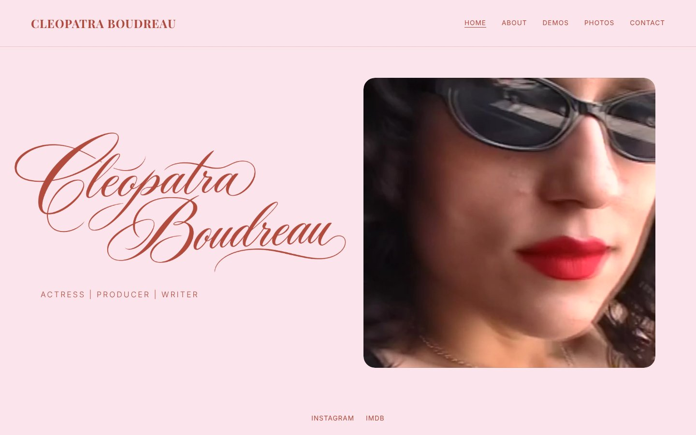

| About | Demos | Photos |
|---|---|---|
| 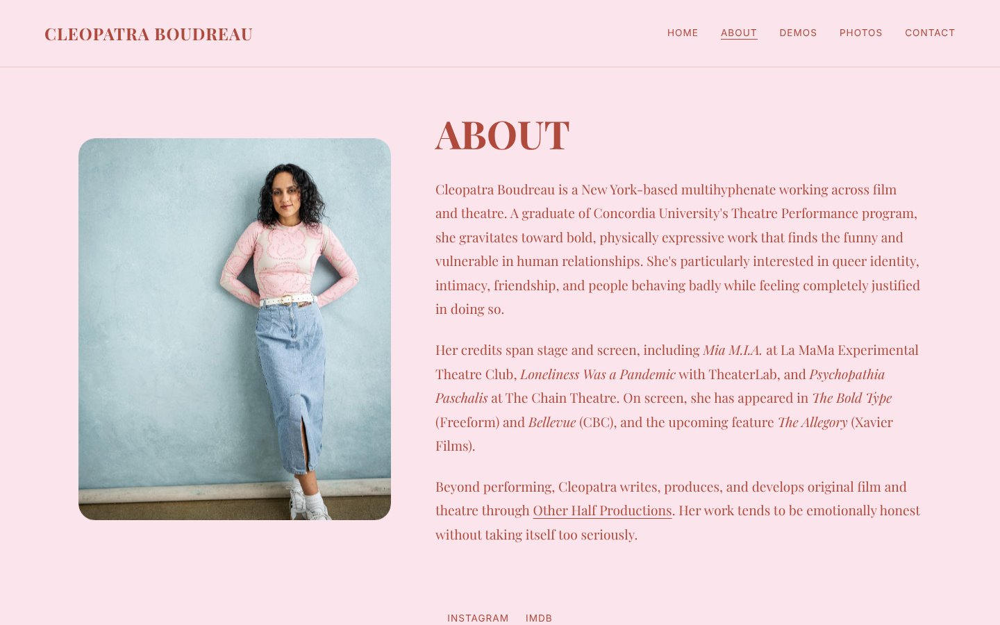 | 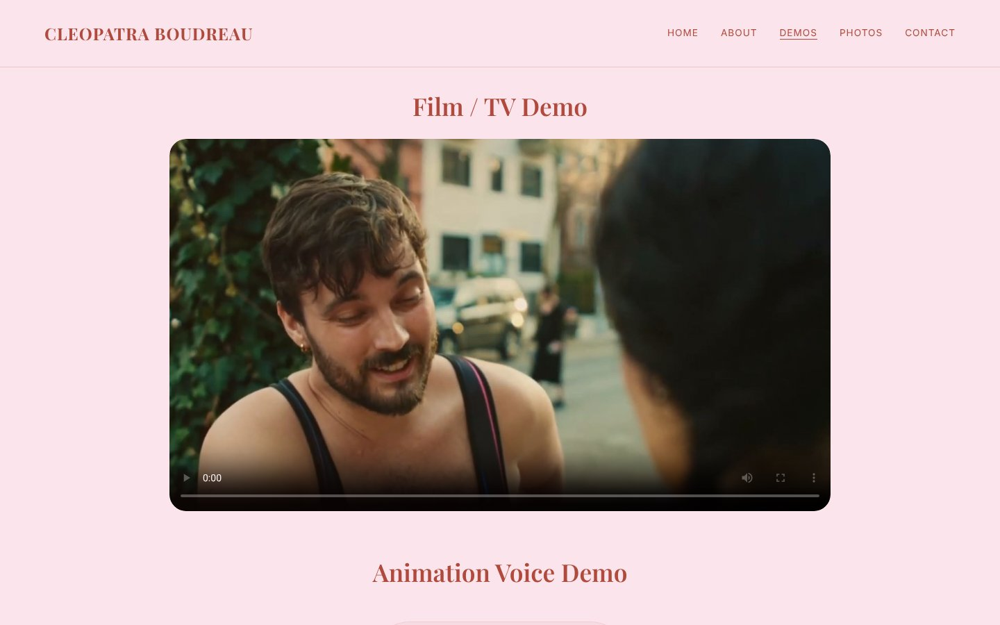 | 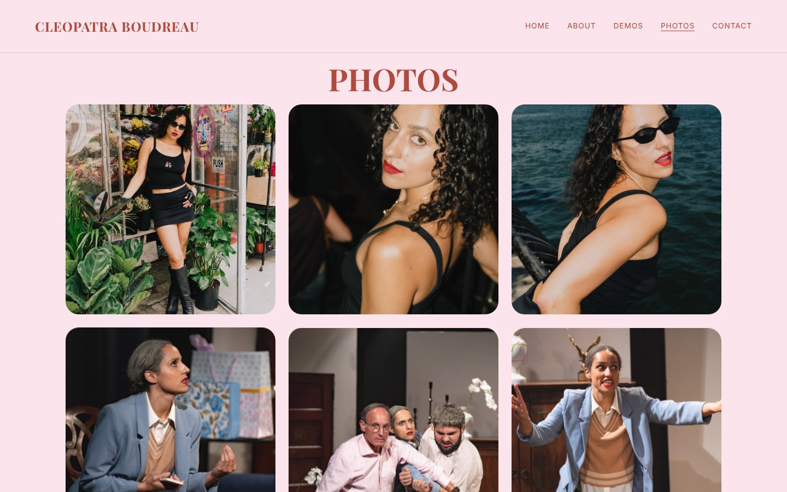 |

| Contact | Mobile |
|---|---|
| 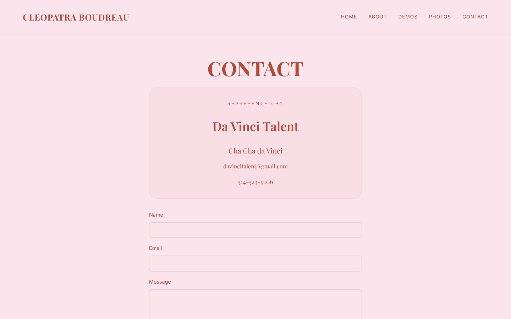 | 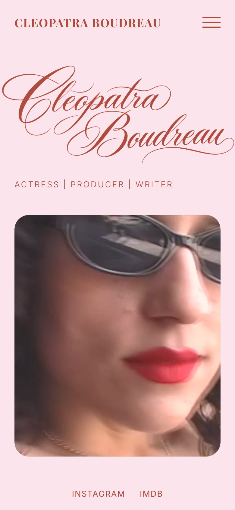 |

### Other Half – film production company

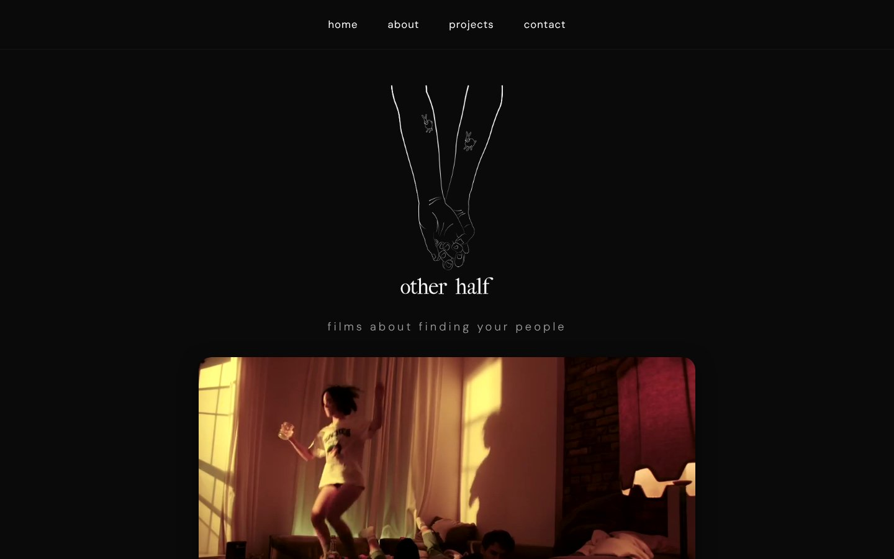

| Full page | Mobile |
|---|---|
| 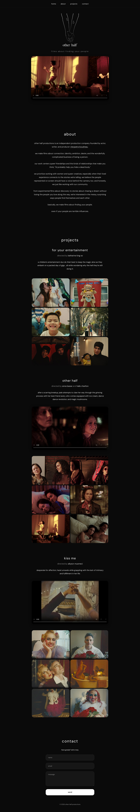 | 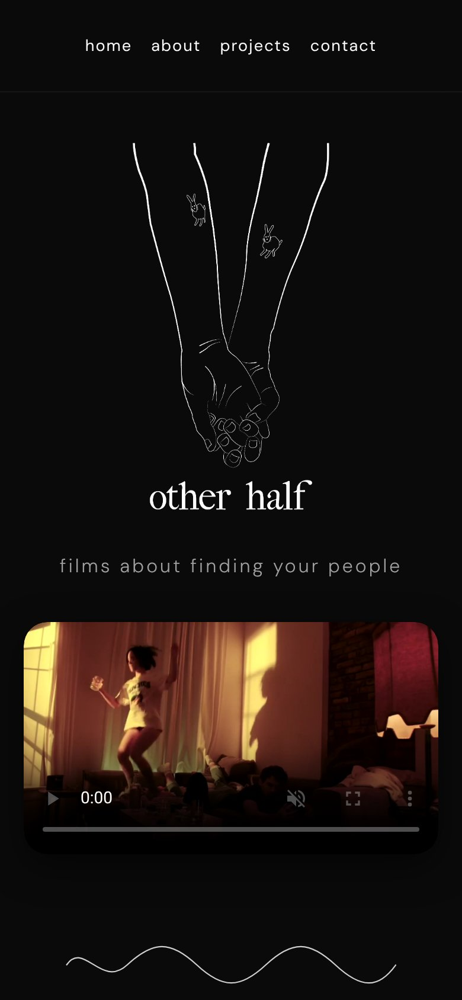 |

### META ANGEL – live event

| Intro | After clicking the logo | Mobile |
|---|---|---|
| 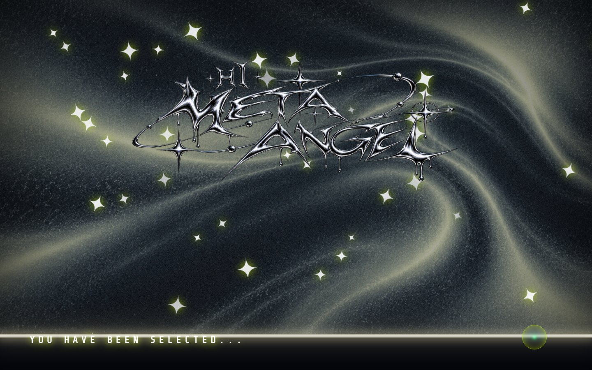 | 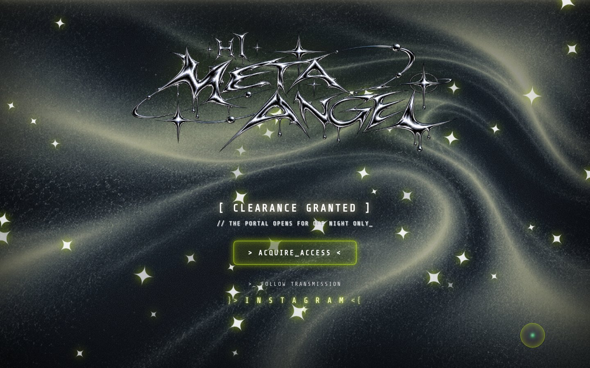 | 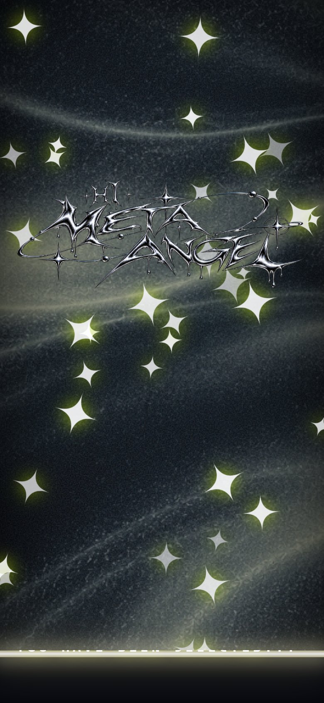 |

## Run locally

Open any `index.html` in a browser.

Videos, audio and full-size photos are not included in this repo because of their size, so the pages with video show empty players locally. See each live site for the full version.

## License

All rights reserved. Client content belongs to the clients. See [LICENSE](LICENSE).
